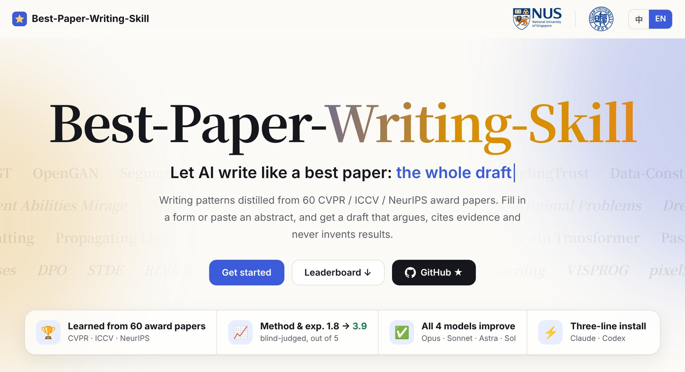
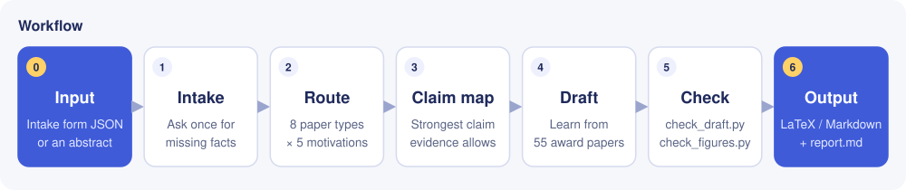

<div align="center">

#  Best-Paper-Writing-Skill

### Write Your Draft Like a Best Paper

Distilled from 60 CVPR / ICCV / NeurIPS award papers　|　Works with Claude, Codex, Gemini and other agents

<p>
<a href="https://gulucaptain.github.io/Best-Paper-Writing-Skill/"></a>
<a href="README_zh.md"></a>
<a href="https://github.com/gulucaptain/Best-Paper-Writing-Skill/stargazers"></a>
<a href="#-installation"></a>
<a href="CHANGELOG.md"></a>
<a href="LICENSE"></a>
</p>

<a href="https://gulucaptain.github.io/Best-Paper-Writing-Skill/"></a>
<br>
<sub>👆 Click to open the project page: video demo, sentence-level before/after, and a blind-judged leaderboard of 4 models</sub>

</div>

<br>

AI-written paper drafts tend to **spend too long on background and stay vague about the contribution**, leaning on words like *novel* and *effective* to sell the method.
We took apart the abstracts and introductions of **60 CVPR, ICCV and NeurIPS award papers** sentence by sentence, and turned the way they explain a piece of work into this skill.

Give it the key points of your research and you get a draft written the way best papers are written, from the title, abstract and introduction to the **method, experiments and schematic figures**. Numbers and citations you did not give stay as `[TODO]`: **it never invents them**.

> [!TIP]
> **Measured result**: on a held-out case, the abstract an AI writes directly gets **1 error and 1 warning** from the checker, and 67% of its sentences end in a “, making …” clause. The version written with this skill gets **0 errors and 0 warnings**, and such sentences drop to **0%**, back within the range of award papers (median 8%).

## ⚡ Quick start

```bash
git clone https://github.com/gulucaptain/Best-Paper-Writing-Skill.git
cd Best-Paper-Writing-Skill && ./install.sh claude      # Codex users: ./install.sh codex
```

Then tell your agent:

> Use Best-Paper-Writing-Skill to write the Title, Abstract and Introduction from this abstract.

## ✨ Features

<table>
<tr>
<td width="33%" valign="top">

### 📝 Abstract & introduction
Credit specific prior work, then name a concrete gap and its cause; the method follows from one observation about the problem; a few numbers carry the claim.

</td>
<td width="33%" valign="top">

### 🧩 Method & experiments
Each component told as need → mechanism → property; ablations mirror the claims; missing table cells stay `\TODO{}`.

</td>
<td width="33%" valign="top">

### 🖼️ Figure planning & drawing
A figure plan first, Figure 1 chosen by line of argument, schematics and method overviews drawn in TikZ; result figures stay placeholders with the plan in the caption.

</td>
</tr>
<tr>
<td valign="top">

### 🧭 Routing by paper type
Method improvement, new capability, empirical law, re-examination, mechanism, theory, dataset, measurement: each type has its own line of argument and exemplars.

</td>
<td valign="top">

### ✅ Checked against the corpus
`check_draft.py` flags boilerplate, participial tails, dashes and excess numbers against award-paper ranges; `style_metrics.py` shows 20 metrics with their corpus percentiles; `check_figures.py` checks captions, references, vector plots and placeholders.

</td>
<td valign="top">

### 📋 Author report
`report.md` lists the claim, the claim-evidence map, every `[TODO]`, open questions, and notes for the Limitations section.

</td>
</tr>
</table>

## 🧠 How it works

<p align="center"></p>

Principles that run through every step:

- **No fabrication.** Numbers, datasets, baselines, citations and result figures come only from your input; anything missing is a `[TODO]` and appears in the report.
- **Strong, not inflated.** Each claim gets the strongest wording its evidence supports: *outperforms* and *first* when the evidence is there, a narrower scope when it is not, never a disclaimer.
- **Learn structure, never copy.** Exemplars teach the order of information and the rhythm; reusing any run of 6 or more words from an exemplar is a violation.
- **Rules with a floor and a ceiling.** Every style metric aims at the award-paper range, so drafts lose the AI habits without collapsing into strings of short sentences.

## 🚀 Two ways to use it

### 📝 Mode A: fill in the intake form

Open [`intake_form.html`](skills/bestpaper-writing/assets/intake_form.html) in a browser (offline, autosaves, exports and re-imports JSON; the interface is in Chinese). Only five fields are required; **the more you fill in, the fewer `[TODO]`s**.

<details>
<summary>What the form asks for</summary>

| Block | Content |
|---|---|
| ⚙️ Setup | venue / year / pages (dropdowns), sections to write (checkboxes) |
| 🔴 Required (5) | one-line claim, task, when prior methods fail, method components, headline results |
| ⭐ Recommended (8) | strongest prior approach, reason for the failure, key observation, closest work, a concrete example, efficiency, what is surprising, the team's name for the idea; the skill asks once for any that are missing |
| 🟢 Optional (folded) | further advantages and applications, paper type, tension type, secondary results, release, limitations, other material, refs.bib |
| 🔵 Method and experiments (folded) | one paste box for your material, plus itemised fields for notation, components, objective, datasets, metrics, baselines, result tables, ablations |

</details>

> Use Best-Paper-Writing-Skill to write the Title, Abstract, Introduction, Method and Experiments from this intake JSON.

### 📄 Mode B: paste an existing abstract

The skill does not rewrite blindly. It maps the abstract back onto the intake fields, shows you **what is present, vague or missing**, asks once for the gaps, and delivers a **change table** (original sentence → revised sentence → the award-paper pattern it follows) so you can accept or reject each change. Your numbers and terminology are kept verbatim.

> Use Best-Paper-Writing-Skill to write the Title, Abstract, Introduction, Method and Experiments from this abstract.

Both modes write Markdown or directly into a LaTeX template. The official [CVPR 2027 author kit](template/CVPR2027/) is included:

> Use Best-Paper-Writing-Skill to write the abstract and introduction into a copy of `template/CVPR2027`: the abstract in `sec/0_abstract.tex`, the introduction in `sec/1_intro.tex`.

## 🩺 Use the checkers on their own

For a draft you already have (Python 3 only, no dependencies):

```bash
S=skills/bestpaper-writing/scripts
python3 $S/check_draft.py   paper/sec/0_abstract.tex paper/sec/1_intro.tex   # ERROR / WARN / NOTE
python3 $S/style_metrics.py paper/sec/0_abstract.tex                         # every metric with its corpus percentile
python3 $S/check_figures.py paper/main.tex                                   # captions, references, vector plots, placeholders
```

```text
ERROR line 3: boilerplate claim
           > Extensive experiments demonstrate the effectiveness of our method on ImageNet, ...
WARN  line 0: abstract: share of sentences ending in a participial clause (', making …', ', extending …');
            merge with because/while/by/which or end the sentence (0.67; 90% of award papers ≤ 0.25)
```

## 📦 Installation

```bash
./install.sh claude     # Claude Code → ~/.claude/skills/
./install.sh codex      # Codex       → ~/.agents/skills/
./install.sh all        # both; add --project to install into the current project
```

| Platform | How |
|---|---|
| **Claude Code** | `./install.sh claude`, or copy `skills/bestpaper-writing/` to `~/.claude/skills/` |
| **Claude web / desktop app** | `cd skills && zip -r bestpaper-writing.zip bestpaper-writing`, then upload the zip in the Skills settings |
| **Codex** | `./install.sh codex`, or copy to `~/.agents/skills/`; invoke explicitly with `$bestpaper-writing` |

Both platforms read the same `SKILL.md`. Restart the agent if the skill does not show up. The helper scripts need Python 3.

## 📚 Corpus and evaluation

**Corpus**: best papers, best student papers and honorable mentions of CVPR, ICCV and NeurIPS, 2021–2025, 60 papers in total.

| Use | Papers | Notes |
|---|---|---|
| Fit the rules | 55 | every sentence of the abstract and introduction labelled by function; structure and style statistics ([corpus-profile.md](skills/bestpaper-writing/references/corpus-profile.md)) |
| Figure statistics | 44 | the papers among the 55 with usable figures; layouts and Figure 1 types ([data/](data/)) |
| Held-out test | 5 | five 2024 papers, removed from the exemplar bank and used only for testing |

By venue: CVPR 22 · ICCV 12 · NeurIPS 26. By type: method improvement 26 · new capability 7 · dataset 6 · measurement 5 · mechanism 5 · theory 4 · empirical law 4 · re-examination 3. Full list: [PAPER_LIST.md](PAPER_LIST.md).

**Held-out test set** ([`evals/`](skills/bestpaper-writing/evals/)): each case gives author notes and a real `refs.bib`; outputs are judged on 13 criteria (invented numbers or citations, compilation, whether the key observation is stated directly, …), and 8-gram overlap with the original is computed to rule out memorisation.

| Case | Original paper (hidden at test time) | Award |
|---|---|---|
| `image-space-motion-prior` | Generative Image Dynamics | CVPR 2024 Best Paper |
| `next-scale-autoregressive-images` | Visual Autoregressive Modeling (VAR) | NeurIPS 2024 Best Paper |
| `taylor-mode-operator-estimator` | Stochastic Taylor Derivative Estimator | NeurIPS 2024 Best Paper |
| `participatory-alignment-dataset` | The PRISM Alignment Dataset | NeurIPS 2024 D&B Best Paper |
| `guidance-with-weaker-model` | Guiding a Diffusion Model with a Bad Version of Itself | NeurIPS 2024 Best Paper Runner-up |

## ❓ FAQ

<details>
<summary><b>What is it for, and what not?</b></summary>

The Title, Abstract, Introduction, Method, Experiments and figure planning of ML / CV papers. For reviewing papers, use the sibling project [Best-Paper-Review-Skill](https://github.com/gulucaptain/Best-Paper-Review-Skill). The corpus comes from CVPR, ICCV and NeurIPS; other fields (NLP, robotics, systems, …) can use it, but the patterns may not hold as well. Contributions to the corpus are welcome.
</details>

<details>
<summary><b>Can it write papers in Chinese?</b></summary>

The rules and statistics come from English papers, so the paper text it writes is in English. You can describe your work in Chinese, and the intake form is in Chinese.
</details>

<details>
<summary><b>Will it copy award papers?</b></summary>

No. Exemplars only teach the order of information and the rhythm of a paragraph; reusing any run of 6 or more words is forbidden, and the evaluation script measures n-gram overlap with the original. The repository contains no paper PDFs or full texts.
</details>

<details>
<summary><b>Why no limitations in the abstract and introduction?</b></summary>

Author preference: limitations, failure cases and disclaimers go to the Limitations section. The skill records them in `report.md` so you can write that section.
</details>

<details>
<summary><b>Why no dashes?</b></summary>

Also an author preference. AI drafts overuse dashes, so the skill uses a colon, a comma, parentheses or a second sentence instead, and `check_draft.py` reports each dash as an ERROR. To drop this rule, remove it from the Hard rules in `SKILL.md`.
</details>

<details>
<summary><b>Repository layout</b></summary>

```
Best-Paper-Writing-Skill/
├── PAPER_LIST.md              # the 60 papers
├── data/                      # papers.csv · figure_stats.json · figure1_types.csv
├── examples/                  # before/after example with checker output
├── template/CVPR2027/         # official CVPR 2027 LaTeX author kit
├── tools/                     # figure statistics script
├── install.sh                 # one-line install
└── skills/bestpaper-writing/
    ├── SKILL.md               # entry point: workflow and hard rules
    ├── references/            # abstract, introduction, method, experiments, figures, routing, style, corpus stats
    │   └── exemplars/         # paragraph and phrase exemplars
    ├── scripts/               # check_draft · check_figures · style_metrics · find_exemplars · intake_to_brief
    ├── assets/                # intake_form.html · figures/ (TikZ styles and templates, matplotlib style)
    ├── evals/                 # held-out test set and graders
    └── agents/openai.yaml     # Codex UI config
```
</details>

## 🧩 The Best-Paper series

Once your draft is written, look at it from the other side. **[Best-Paper-Review-Skill](https://github.com/gulucaptain/Best-Paper-Review-Skill)** is our reviewing skill, also for Claude and Codex.

<table>
<tr>
<th width="50%">✍️ Best-Paper-Writing-Skill (this repo)</th>
<th width="50%">🔍 <a href="https://github.com/gulucaptain/Best-Paper-Review-Skill">Best-Paper-Review-Skill</a></th>
</tr>
<tr>
<td valign="top">

Drafts the abstract, introduction, method, experiments and figures the way award papers are written; numbers and citations you did not give stay as `[TODO]`.

[Project page](https://gulucaptain.github.io/Best-Paper-Writing-Skill/)

</td>
<td valign="top">

Reviews a paper claim by claim: quotes come only from the PDF and a script checks their page numbers, a sub-agent searches prior work for each contribution, and every criticism is tested against the authors' defense and re-checked by an independent critic. Outputs a review in Chinese and an English review ready to submit.

[Project page](https://gulucaptain.github.io/Best-Paper-Review-Skill/) · [GitHub](https://github.com/gulucaptain/Best-Paper-Review-Skill)

</td>
</tr>
</table>

> [!NOTE]
> Many conferences restrict the use of LLMs in reviewing; check your venue's policy before using the Review skill. It is an assistant, and its conclusions are yours to verify.

## 📖 Citation

If the skill helps your writing, please cite:

```bibtex
@misc{bestpaperwritingskill2026,
  title        = {Best-Paper-Writing-Skill: Writing Papers the Way Award Papers Are Written},
  author       = {{Best-Paper-Writing-Skill contributors}},
  year         = {2026},
  howpublished = {\url{https://github.com/gulucaptain/Best-Paper-Writing-Skill}}
}
```

## 🤝 Contributing

Issues, corpus additions from other fields, and drafts you wrote with the skill are all welcome. If it helps you, a ⭐ star helps others find it.

## 📄 License and acknowledgements

- Original content (instructions, templates, scripts) is licensed under [CC BY 4.0](LICENSE).
- Short quotations in `references/exemplars/` are used for teaching commentary with attribution; copyright stays with the original authors, so do not copy them into new papers. The repository **contains no paper PDFs or full texts**; if you are an author and want a quotation adjusted or removed, please open an issue.

<div align="center">

<a href="https://star-history.com/#gulucaptain/Best-Paper-Writing-Skill&Date"></a>

</div>
