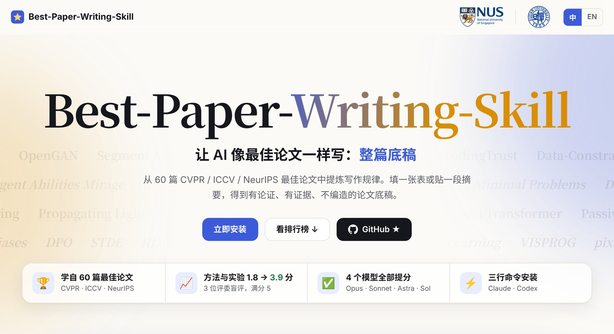
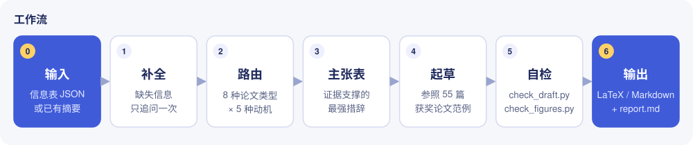

<div align="center">

#  Best-Paper-Writing-Skill

### 按Best Paper的写法，写出你的高质量论文底稿

规则提炼自60篇CVPR / ICCV / NeurIPS获奖论文　|　多智能体(Claude, Codex, Gemini等)通用

<p>
<a href="https://gulucaptain.github.io/Best-Paper-Writing-Skill/"></a>
<a href="README.md"></a>
<a href="https://github.com/gulucaptain/Best-Paper-Writing-Skill/stargazers"></a>
<a href="#-安装"></a>
<a href="CHANGELOG.md"></a>
</p>

<a href="https://gulucaptain.github.io/Best-Paper-Writing-Skill/"></a>
<br>
<sub>👆 点击图片进入项目主页：视频演示、逐句前后对比、4个模型的盲评排行榜</sub>

</div>

<br>

用AI写出来的论文初稿，常常**背景铺得很长，贡献却说不清楚**，方法全靠novel、effective撑场面。
我们逐句拆解了**60篇CVPR、ICCV、NeurIPS获奖论文**的摘要和引言，把它们讲清一个工作的方式整理成了这个Skill。

把研究要点交给它，你会拿到一份按Best Paper论文思路写好的初稿，从标题、摘要、引言一直到**方法、实验和示意图**。没给的数字和引用，它只留`[TODO]`，**绝不编造**。

> [!TIP]
> **实测效果**：在留出测试集的一个case上，直接让AI写的摘要被检查器标出**1个错误、1个警告**，67%的句子以“, making …”式分词短语收尾；按这个Skill写的版本**0错误、0警告**，这类句子降到**0%**，回到获奖论文的范围（中位数8%）

## ⚡ 30秒上手

```bash
git clone https://github.com/gulucaptain/Best-Paper-Writing-Skill.git
cd Best-Paper-Writing-Skill && ./install.sh claude      # Codex 用户：./install.sh codex
```

然后对agent说：

> 用Best-Paper-Writing-Skill，根据这段摘要写出论文的Title、Abstract和Introduction。

## ✨ 功能

<table>
<tr>
<td width="33%" valign="top">

### 📝 摘要与引言
先具体肯定前人，再点明缺口及其原因；方法从一个关于问题的观察推出；少数几个数字撑起主张。

</td>
<td width="33%" valign="top">

### 🧩 方法与实验
每个组件按“需要 → 机制 → 性质”展开；消融实验与主张一一对应；表格缺数处留`\TODO{}`。

</td>
<td width="33%" valign="top">

### 🖼️ 配图规划与绘制
先列图像规划表，按论证路线选Figure 1类型，用TikZ直接画示意图和方法总览；结果图留白，规划写进图注。

</td>
</tr>
<tr>
<td valign="top">

### 🧭 按论文类型路由
方法改进、新能力、规模规律、再检验、机理分析、理论、数据集、测量八类论文，各有一条论证路线和对应范例。

</td>
<td valign="top">

### ✅ 对照语料自检
`check_draft.py`对照获奖论文的分布，标出套话、分词尾句、破折号和超量数字；`style_metrics.py`给出20项指标的语料分位数；`check_figures.py`检查图注、引用、矢量图与占位图。

</td>
<td valign="top">

### 📋 作者报告
`report.md`给出核心主张、主张-证据表、`[TODO]`清单、待回答的问题，以及留给Limitations一节的要点。

</td>
</tr>
</table>

## 🧠 它怎么工作

<p align="center"></p>

几条贯穿全流程的原则：

- **不编造。** 数字、数据集、基线、引用、结果图都只来自你的输入；缺的标`[TODO]`，并在报告里列出。
- **强而不虚。** 每个主张用证据所能支撑的最强措辞：证据够就说 *outperforms*、*first*，不够就收窄范围，而不是加免责声明。
- **学结构，不抄句子。** 范例库只用来学习信息顺序和节奏；与范例连续6个词相同即视为违规。
- **规则有上下限。** 每条风格指标都对齐获奖论文的中位数区间，既不让AI腔超标，也不把句子压成一串短句。

## 🚀 两种输入方式

### 📝 方式一：填写信息表

用浏览器打开[`intake_form.html`](skills/bestpaper-writing/assets/intake_form.html)（离线可用，自动保存草稿，可导出和再次导入JSON）。必填只有5项，**填得越详细，`[TODO]`越少**。

<details>
<summary>表单包含哪些字段</summary>

| 档位 | 内容 |
| --- | --- |
| ⚙️ 基本设置 | 会议/年份/页数（下拉），需要写哪些部分（勾选） |
| 🔴 必填（5） | 一句话说清这篇工作、任务、现有方法在什么情况下不行、方法组成、头条结果 |
| ⭐ 推荐（8） | 现有最强方法、失败原因、核心观察、最相近工作、具体画面、效率优势、反直觉之处、团队内部的叫法；缺了skill会先追问一次 |
| 🟢 补充（折叠） | 额外优势与应用、论文类型、矛盾类型、次要结果、开源内容、局限、其他材料、refs.bib |
| 🔵 方法与实验（折叠） | 一个直接粘贴材料的大框；需要时再逐项填写符号、组件、目标、数据集、指标、对比方法、结果表、消融 |

</details>

> 用Best-Paper-Writing-Skill，根据这份信息表JSON写出论文的Title、Abstract、Introduction、Methods和Experiments。

### 📄 方式二：贴入已有摘要

skill不会盲目重写。它先把摘要拆回信息表的字段，告诉你**哪些已有、哪些模糊、哪些缺失**，一次性追问缺项；写完后附一张**修改对照表**（原句 → 改后句 → 依据的获奖论文写法），你可以逐条接受或拒绝。你的数字和术语原样保留。

> 用Best-Paper-Writing-Skill，根据这段摘要写出论文的Title、Abstract、Introduction、Methods和Experiments。

两种方式都可以输出Markdown，或直接写进LaTeX模板。仓库自带官方[CVPR 2027 author kit](template/CVPR2027/)：

> 用Best-Paper-Writing-Skill写摘要和引言，直接写进`template/CVPR2027`的副本，摘要放`sec/0_abstract.tex`，引言放`sec/1_intro.tex`。

## 🩺 单独使用检查器

已经写好的稿子，也可以只用检查器（只需Python 3，无第三方依赖）：

```bash
S=skills/bestpaper-writing/scripts
python3 $S/check_draft.py   paper/sec/0_abstract.tex paper/sec/1_intro.tex   # ERROR / WARN / NOTE
python3 $S/style_metrics.py paper/sec/0_abstract.tex                         # 每项指标及其语料分位数
python3 $S/check_figures.py paper/main.tex                                   # 图注、引用、矢量图、占位图
```

```text
ERROR line 3: boilerplate claim
           > Extensive experiments demonstrate the effectiveness of our method on ImageNet, ...
WARN  line 0: abstract: share of sentences ending in a participial clause (', making …', ', extending …');
            merge with because/while/by/which or end the sentence (0.67; 90% of award papers ≤ 0.25)
```

## 📦 安装

```bash
./install.sh claude     # Claude Code → ~/.claude/skills/
./install.sh codex      # Codex       → ~/.agents/skills/
./install.sh all        # 两个都装；末尾加 --project 则装到当前项目目录
```

| 平台 | 方式 |
| --- | --- |
| **Claude Code** | `./install.sh claude`，或把`skills/bestpaper-writing/`复制到`~/.claude/skills/` |
| **Claude网页/桌面应用** | `cd skills && zip -r bestpaper-writing.zip bestpaper-writing`，在Skills设置中上传zip |
| **Codex** | `./install.sh codex`，或复制到`~/.agents/skills/`；用`$bestpaper-writing`显式调用 |

两个平台使用同一份`SKILL.md`。装好后若看不到，重启agent。辅助脚本需要Python 3。

## 📚 语料与评测

**语料**：2021–2025年CVPR、ICCV、NeurIPS的最佳论文、最佳学生论文与荣誉提名，共60篇。

| 用途 | 篇数 | 说明 |
| --- | --- | --- |
| 拟合规则 | 55 | 摘要和引言逐句标注功能，统计结构与风格指标（[corpus-profile.md](skills/bestpaper-writing/references/corpus-profile.md)） |
| 配图统计 | 44 | 上述55篇中有可用配图的论文，统计版式与Figure 1类型（[data/](data/)） |
| 留出测试 | 5 | 2024年的5篇，从范例库中移除，只用于测试 |

按会议：CVPR 22 · ICCV 12 · NeurIPS 26。按类型：方法改进26 · 新能力7 · 数据集6 · 测量5 · 机理分析5 · 理论4 · 规模规律4 · 再检验3。完整清单见[PAPER_LIST.md](PAPER_LIST.md)。

**留出测试集**（[`evals/`](skills/bestpaper-writing/evals/)）：每个case给出作者笔记和真实的`refs.bib`，用13条评分标准评判输出（是否编造数字与引用、能否编译、关键观察是否直接说出等），并计算与原文的8-gram重叠以排除背诵。

| Case | 原论文（测试时隐藏） | 奖项 |
| --- | --- | --- |
| `image-space-motion-prior` | Generative Image Dynamics | CVPR 2024 Best Paper |
| `next-scale-autoregressive-images` | Visual Autoregressive Modeling (VAR) | NeurIPS 2024 Best Paper |
| `taylor-mode-operator-estimator` | Stochastic Taylor Derivative Estimator | NeurIPS 2024 Best Paper |
| `participatory-alignment-dataset` | The PRISM Alignment Dataset | NeurIPS 2024 D&B Best Paper |
| `guidance-with-weaker-model` | Guiding a Diffusion Model with a Bad Version of Itself | NeurIPS 2024 Best Paper Runner-up |

## ❓ 常见问题

<details>
<summary><b>适合什么，不适合什么？</b></summary>

适合ML/CV论文的Title、Abstract、Introduction、Method、Experiments和配图规划。要审稿，请用姊妹项目[Best-Paper-Review-Skill](https://github.com/gulucaptain/Best-Paper-Review-Skill)。语料来自CVPR、ICCV、NeurIPS，其他领域（NLP、机器人、系统等）可以用，但规律未必同样成立，欢迎补充语料。
</details>

<details>
<summary><b>能写中文论文吗？</b></summary>

规则和统计都来自英文论文，输出的论文正文是英文。你可以用中文描述工作，信息表界面也是中文。
</details>

<details>
<summary><b>会不会抄获奖论文？</b></summary>

不会。范例只用来学习段落的信息顺序和节奏，规则禁止复用范例中任何连续6个词；评测脚本会计算输出与原文的n-gram重叠。仓库不含任何论文PDF或全文。
</details>

<details>
<summary><b>为什么摘要和引言里不写局限？</b></summary>

这是作者偏好：局限、失败案例和免责声明统一放到Limitations一节。skill会把它们记进`report.md`，方便你写那一节。
</details>

<details>
<summary><b>为什么不用破折号？</b></summary>

同样是作者偏好。破折号在AI草稿里出现得过多，skill改用冒号、逗号、括号或另起一句；`check_draft.py`会把破折号报为ERROR。不想要这条规则，可以在`SKILL.md`的Hard rules里删掉。
</details>

<details>
<summary><b>目录结构</b></summary>

```
Best-Paper-Writing-Skill/
├── PAPER_LIST.md              # 60 篇论文清单
├── data/                      # papers.csv · figure_stats.json · figure1_types.csv
├── examples/                  # 效果示例与检查器输出
├── template/CVPR2027/         # 官方 CVPR 2027 LaTeX 模板
├── tools/                     # 语料配图统计脚本
├── install.sh                 # 一键安装
└── skills/bestpaper-writing/
    ├── SKILL.md               # 入口：工作流与硬性规则
    ├── references/            # 摘要、引言、方法、实验、配图、路由、风格规则、语料统计
    │   └── exemplars/         # 段落与句式范例库
    ├── scripts/               # check_draft · check_figures · style_metrics · find_exemplars · intake_to_brief
    ├── assets/                # intake_form.html · figures/（TikZ 样式与模板、matplotlib 样式）
    ├── evals/                 # 留出测试集与评分标准
    └── agents/openai.yaml     # Codex 界面配置
```
</details>

## 🧩 Best-Paper系列

写完之后，可以换个角度再审一遍。[Best-Paper-Review-Skill](https://github.com/gulucaptain/Best-Paper-Review-Skill)是我们的审稿Skill，同样支持Claude与Codex。

<table>
<tr>
<th width="50%">✍️ Best-Paper-Writing-Skill（本仓库）</th>
<th width="50%">🔍 <a href="https://github.com/gulucaptain/Best-Paper-Review-Skill">Best-Paper-Review-Skill</a></th>
</tr>
<tr>
<td valign="top">

按获奖论文的写法写出摘要、引言、方法、实验和配图底稿，没给的数字和引用一律留`[TODO]`。

[项目主页](https://gulucaptain.github.io/Best-Paper-Writing-Skill/)

</td>
<td valign="top">

逐条审查论文的核心主张：引文只来自PDF并由脚本核对页码，每项贡献由子agent检索前人工作，每条批评先经作者视角反驳、再由独立agent复核。输出中文审稿意见和可直接提交的英文review。

[项目主页](https://gulucaptain.github.io/Best-Paper-Review-Skill/) · [GitHub](https://github.com/gulucaptain/Best-Paper-Review-Skill)

</td>
</tr>
</table>

> [!NOTE]
> 不少会议限制在审稿中使用LLM，使用Review-Skill前请先确认所投会议的政策；它只是辅助工具，结论需要你自己核实。

## 📖 引用

如果这个skill对你的写作有帮助，欢迎引用：

```bibtex
@misc{bestpaperwritingskill2026,
  title        = {Best-Paper-Writing-Skill: Writing Papers the Way Award Papers Are Written},
  author       = {{Best-Paper-Writing-Skill contributors}},
  year         = {2026},
  howpublished = {\url{https://github.com/gulucaptain/Best-Paper-Writing-Skill}}
}
```

## 🤝 参与

欢迎通过Issue反馈问题、补充语料中缺少的领域，或分享你用它写出的稿子。如果它对你有帮助，欢迎点一个 ⭐ Star。

## 📄 许可与致谢

- 原创内容（说明、模板、脚本）采用[CC BY 4.0](LICENSE)。
- `references/exemplars/`中的论文短句仅作教学评论引用并注明出处，版权归原作者，请勿复制进新论文。仓库**不含任何论文PDF或全文**；如果你是原作者，希望调整或移除相关引用，请提Issue。

<div align="center">

<a href="https://star-history.com/#gulucaptain/Best-Paper-Writing-Skill&Date"></a>

</div>
